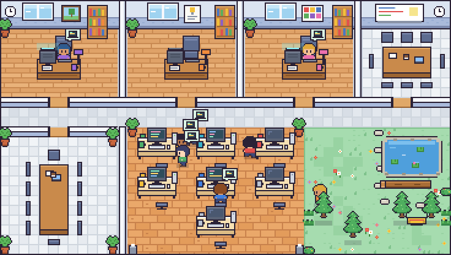
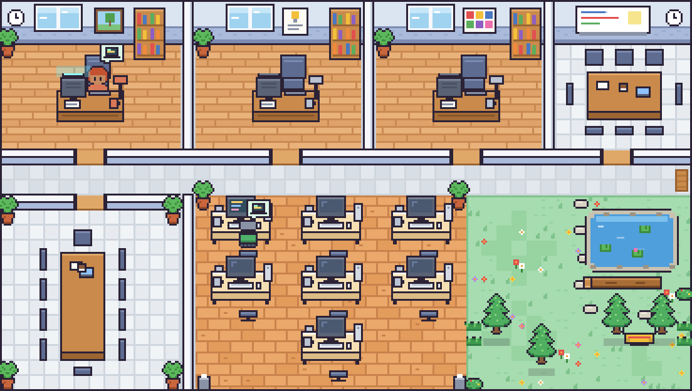

<div align="center">


# Agent Office

**See at a glance which of your Claude Code agents is working right now.**

[](../../releases/latest)
[](LICENSE)


[Getting started](#getting-started) · [How it works](#how-it-works) · [Settings](#settings) · [FAQ](#faq) · [Technical docs](docs/TECHNICAL.md)



</div>

A tiny pixel-art office that lives in a VS Code panel, or in its own desktop window when you don't use VS Code. When one of your Claude Code agents starts working, its character walks to its desk. When an agent delegates, the others gather in a meeting room. When a job is done, the result is brought back to whoever asked for it. And when there's nothing to do, everyone heads to the pond or the hammock.

## Features

- **Live status**: see which agent is working, idle or in an unknown state, refreshed every 2 seconds.
- **Real delegations**: visits, meetings and hand-ins are triggered by what your agents actually do.
- **Zero setup**: agents, desks and colors are detected automatically.
- **Only this project's sessions**: the office comes alive for the Claude Code sessions started in the open folder, not those of your other projects. Your own agents (`~/.claude/agents`) are always at their desks.
- **Settings at hand**: the ⚙ button (in the view's title bar in VS Code, at the right of the folder bar in the desktop app) changes the main settings in a click.
- **Seasonal decorations**: for now, winter from December 1 to January 6, with snow outside the windows and on the lounge, garlands in the corridors, a Christmas tree, presents and Santa hats.
- **Claude itself has a desk**: when you talk to Claude Code without a custom agent, a **Claude** character works, delegates to your agents, and shows the model it's using (e.g. Opus 5.5). No custom agent needed to see the office come alive.
- **Mini-bots for the other subagents**: built-in subagents (Explore, Plan, general-purpose…) and extra copies of an agent already at work roll in as small tracked robots and take a free desk.
- **Edit an agent in one click**: click a character, it turns to face you, and **Edit agent file** opens its `.md` in the editor. Restart Claude Code to apply your changes.
- **Dismiss a stuck subagent**: a subagent left grey with a “?” (interrupted, never marked as finished) can be sent home from its card. It packs its plant and mug in a cardboard box and hurries out the door. Claude Code itself is not touched.
- **Private by design**: 100% local and read-only. No code, prompt or conversation is ever displayed.

## Getting started

### 1. Add custom agents (optional)

> [!NOTE]
> **The office works without any custom agent.** Claude itself has a desk, and the subagents it launches show up as mini-bots.
>
> Custom agents give the office its team: each one gets its own character, desk and color. A custom agent is a `.md` file in `~/.claude/agents/` (for all your projects) or in your project's `.claude/agents/` folder. You can create them with the `/agents` command in [Claude Code](https://docs.claude.com/en/docs/claude-code/overview).

**Want a team?** Paste the prompt below into Claude Code. It creates a complete development team of 9 agents, like the one in the animation, with one simple rule: you only talk to the product manager, and no code changes without your explicit “GO”.

<details>
<summary><b>📋 Prompt: create a complete development team (9 agents)</b></summary>

```text
Create a team of 9 Claude Code custom agents for software development, as
Markdown files in ~/.claude/agents/ (create the folder if needed). If a file
with the same name already exists, show it to me and ask before overwriting.

Each file starts with a YAML frontmatter containing: name, description (one
or two sentences saying when to use the agent), tools, model: inherit, and
color. Below the frontmatter, write a complete system prompt in the second
person ("You are the..."): role, responsibilities, how it works step by step,
what it must never do, and the format of its answer. Every agent reads the
project's CLAUDE.md first and follows its rules.

The team works around one rule: the product manager is my only contact, and
no code changes without my explicit "GO". Pushing, merging or deploying needs
a second, separate confirmation from me.

1. product-manager (color: purple)
   My single point of contact. Clarifies each request (need, users, acceptance
   criteria), then delegates to the smallest useful set of agents with the
   Agent tool, never playing their role itself. For any new feature, asks the
   product-challenger first. Consolidates their opinions into one short report
   with a recommendation, then waits for my "GO" before any implementation.
   Writes self-contained briefs (scope, out of scope, files to read, expected
   answer). Never edits files itself.
   tools: Agent(product-challenger, ux-ui-designer, tech-lead,
   developer-frontend, developer-backend, qa-engineer,
   documentation-engineer, administrator), Read, Grep, Glob, Bash,
   AskUserQuestion

2. product-challenger (color: orange)
   Framing partner of the product manager, consulted early for each feature.
   Looks at what comparable products do, then challenges the idea with 2 or 3
   argued, sourced alternatives and recommends a direction. Read-only.
   tools: Read, Grep, Glob, WebSearch, WebFetch

3. ux-ui-designer (color: pink)
   Designs user flows and screens and shows them as self-contained, very
   visual HTML mockups (variants side by side, clickable flow), saved outside
   the repository in ~/.claude/artifacts/<project>/. Never modifies the
   repository.
   tools: Read, Grep, Glob, Write, Edit, Bash

4. tech-lead (color: blue)
   Architecture, feasibility, risks, security, task split and code review.
   Read-only by default; implements a complex part only when the brief
   contains "GO confirmed by the user", in an isolated Git worktree.
   tools: Read, Grep, Glob, Edit, Write, Bash

5. developer-frontend (color: cyan)
   Interfaces, components, mockup integration, interactions, accessibility,
   frontend tests. Before the GO, proposes a plan without changing anything.
   After the GO, implements and tests in an isolated Git worktree.
   tools: Read, Grep, Glob, Edit, Write, Bash

6. developer-backend (color: green)
   APIs, services, business logic, data, integrations, security, backend
   tests. Same two modes as developer-frontend: plan before the GO,
   implementation in an isolated Git worktree after.
   tools: Read, Grep, Glob, Edit, Write, Bash

7. qa-engineer (color: red)
   Acceptance criteria, functional and technical tests, regressions,
   compliance with the design mockups. Before implementation, lists test
   scenarios proportionate to the risk. After, reviews and tests the branch
   without changing the code.
   tools: Read, Grep, Glob, Bash, Write, Edit

8. documentation-engineer (color: yellow)
   Documents the project for the other agents in docs/ai/ (a shared index
   plus one page per role) so they don't have to explore the code again; it's
   its first mission on any project without docs/ai/index.md. Updates it after
   important changes. Only writes in docs/.
   tools: Read, Grep, Glob, Write, Edit, Bash

9. administrator (no color)
   Privileged operations, only when the brief quotes my confirmation word for
   word: merging into the main branch, pushing, cleaning up worktrees and
   branches, editing agent files or Claude Code settings. Never writes
   features, never force-pushes, never rewrites history, never handles
   secrets.
   tools: Read, Grep, Glob, Bash, Edit, Write

When you're done, list the files you created and tell me how to start
working with the team.
```

</details>

### 2. Install

#### In VS Code

1. Download **`agent-office-x.y.z.vsix`** from the [latest release](../../releases/latest) (under *Assets*).
2. In VS Code, open the **Extensions** view, click the **`···`** menu at the top, choose **Install from VSIX…** and pick the file.
3. Click the **Agent Office** tab at the bottom of VS Code, next to *Terminal*. 🎉

<details>
<summary>Prefer the terminal?</summary>

```bash
code --install-extension ~/Downloads/agent-office-*.vsix
```

</details>

#### Without VS Code

The office also runs as a standalone desktop app (built with [Electron](https://www.electronjs.org/)). It opens in its own **window**, reads the same local files as the extension, and works next to any terminal or editor. The window title and, on macOS, the Dock badge show whether an agent is working.



Download it from the [latest release](../../releases/latest) (under *Assets*): the **`.dmg`** for macOS, or the **`Setup .exe`** (installer) or portable **`.exe`** for Windows.

**Choose a working folder.** Your own agents (`~/.claude/agents`) always show up, but a project's agents (its `.claude/agents` folder) only appear once you pick that project, like opening a folder in VS Code. Use the **Folder** bar at the top of the window (or **File → Open Folder…**, `Cmd/Ctrl+O`):

- Each window has its own folder. **New Window…** (`Cmd/Ctrl+N`, or ⧉ next to a recent folder) opens another folder side by side.
- Visited folders are remembered. Click one in the **Folder** list to switch to it, or use **File → Open Recent** (`Cmd/Ctrl+1…9`). **✕** or **File → Remove from Recent List** forgets a folder (it is never deleted from disk), **Clear Recent List** forgets them all.
- The last folder is reopened at the next launch, and the window title shows the folder and the working agent.

Or build it from a clone (Node.js 18 or later):

```bash
npm install
npm run app            # compile and open the window
npm run app:dist       # build an installer for this OS into dist/
```

`npm run app:dist:mac` produces a `.dmg` and a `.zip`; `npm run app:dist:win` produces an installer and a portable `.exe`. Pushing a `v*` tag that matches the `package.json` version builds these files and the `.vsix` on GitHub Actions and attaches them to the release.

Installers are not code-signed. On macOS, the first launch is blocked: open *System Settings → Privacy & Security* and click *Open Anyway* (if macOS says the app is damaged, run `xattr -cr "/Applications/Agent Office.app"`). On Windows, SmartScreen shows a warning: click *More info → Run anyway*.

| System | Status |
|---|---|
| macOS (Apple Silicon) | Tested, from source and as a packaged app |
| Windows | Built by the CI workflow (`.github/workflows/app.yml`), not tested yet |
| Linux | Not supported yet |

### 3. Put your agents to work

Start Claude Code as usual, or with one of your agents, for example:

```bash
claude                          # the Claude character works
claude --agent product-manager  # the product manager works
```

Ask it for something. As soon as it starts, its character walks to its desk with a 💻 bubble, and the status bar at the bottom of VS Code (or the title of the desktop window) reads *“Active agent: product-manager”*. When it delegates, the custom agents it launches walk to their desks, and the other subagents roll in as mini-bots.

## How it works

Everything is automatic. The extension:

1. **finds your agents** in `~/.claude/agents/` and in the open project's `.claude/agents/`, and shows up to 10 of them, plus a **Claude** character for the sessions you start without `--agent`, and a **mini-bot** for each running subagent that has no character of its own;
2. **gives each one a desk** based on its name, or its description when the name says nothing about the role:

   | Name or description mentions… | Desk |
   |---|---|
   | product manager, product owner | Product manager's office |
   | challenger | Challenger's office |
   | UX, UI, design | UX/UI office |
   | anything else | Engineering open space |

3. **gives each one a color**: the `color:` from the agent's file, or else one no other agent is using;
4. **reads Claude Code's local activity files** every 2 seconds to know who's working and who delegates to whom, only for the sessions started in the open folder (or one of its subfolders) unless you choose **All projects**.

Above each character, a bubble tells you what's going on:

| Bubble | Meaning |
|:---:|---|
| 💻 | **Working**, from the moment it starts, even while walking to its desk |
| 👥 | **In a meeting**: an agent delegated to several others at once |
| 📄 | **Handing in its work** to the agent that asked for it |
| ✅ | **Work accepted** by the agent that delegated |
| 💤 ☕ | **Free**: wandering, chatting by the pond, napping in the hammock |
| ❓ | **Unknown**: the character turns grey, its status can't be determined |

## Settings

Everything works out of the box. To change the main settings, click the **⚙** in the Agent Office view's title bar in VS Code (or run *Agent Office: Office settings*), or at the right of the folder bar in the desktop app. Changes apply right away:

| In the ⚙ panel | Choices | What it does |
|---|---|---|
| **Sessions shown** | This project (default) / All projects | *This project*: only the Claude Code sessions started in the open folder or its subfolders animate the office. Your own agents (`~/.claude/agents`) and the project's agents are always shown, but an agent working in another project stays idle here. With no folder open, every session is shown. |
| **Show Claude** | On (default) / Off | The **Claude** character for sessions started without a custom agent |
| **Grey after** | 5, 10, 20 (default) or 60 min | How long a subagent can stay silent before it turns grey with a “?” |
| **Seasonal decor** | On (default) / Off | *On*: the office follows the seasons (for now, winter from December 1 to January 6). *Off*: never decorated. |

The ⚙ panel saves to your regular settings: in VS Code, your user settings (or the workspace settings if the value is already set there).

For the other settings, open Settings in VS Code and search for **Agent Office**. In the desktop app, the same options live in a `settings.json` file (menu **File → Open Settings File**), with the keys below minus the `agentOffice.` prefix, e.g. `{ "pollIntervalSeconds": 5 }`. Changes apply live. The optional `projectFolders` list names folders whose `.claude/agents` are always read, in every window.

| Setting | Default | What it does |
|---|---|---|
| `agentOffice.agentRooms` | `{}` | Force an agent's desk, e.g. `{ "my-agent": "design" }` (`pm`, `challenger`, `design` or `engineering`) |
| `agentOffice.pinnedAgents` | `[]` | Agents shown first when you have more than 10 |
| `agentOffice.sessionScope` | `project` | `project`: only the sessions started in the open folders; `all`: every session on this machine |
| `agentOffice.showDefaultClaude` | `true` | Show the **Claude** character for sessions started without a custom agent |
| `agentOffice.subagentSilenceMinutes` | `20` | Minutes of silence before a subagent turns grey with a “?” |
| `agentOffice.seasonalDecor` | `true` | Seasonal decorations, following the date (for now, winter) |
| `agentOffice.pollIntervalSeconds` | `2` | Refresh interval, in seconds |

`agentOffice.claudeConfigDir` is described in the [technical docs](docs/TECHNICAL.md#signal-sources-claude-code).

## Privacy

- **100% local**: the extension makes no network request.
- **Read-only**: it never changes a Claude Code or agent file and never starts, stops or controls an agent. The only thing it writes is its own settings, when you use the ⚙ panel. Dismissing a stuck subagent only hides it in the office.
- **Nothing of your work is shown**: only agent names, statuses, the Claude model name and timestamps reach the office view.

## Known limitations

- **Claude Code only.** GitHub Copilot agents are listed but stay grey: Copilot exposes no activity signal.
- **Relies on Claude Code internals.** Activity is read from local files that Claude Code doesn't officially document. A Claude Code update may break detection; the office then shows “Unknown status” rather than guessing.
- **Tested on macOS.** Linux and Windows should work but haven't been tested yet: feedback welcome.
- **10 agents max** in the office. Extra agents are listed below it.
- **Sessions outside the project folder** (started from your home folder, or from a worktree outside the project) are hidden with **This project**. Switch to **All projects** to see them.

More details in the [technical docs](docs/TECHNICAL.md#limits).

## FAQ

<details>
<summary><b>My agents have random names and no colors. Can I tidy them up in one go?</b></summary>

Yes. Open Claude Code in your project and paste this prompt:

```text
Look at all my Claude Code agents: the .md files in ~/.claude/agents/ and in
.claude/agents/ of this project. Then:

1. Colors: in each agent's frontmatter, add or update the `color:` line using only
   red, blue, green, yellow, purple, orange, pink or cyan. Give every agent a
   different color. If I have more than 8 agents, leave the extra ones without a
   color. Don't change `name:` or anything else in the files.

2. Rooms for the Agent Office VS Code extension: pick a room for each agent:
   - "pm": the agent that leads, coordinates or talks to me (at most one)
   - "challenger": the agent that criticizes and challenges ideas (at most one)
   - "design": the UX/UI agent (at most one)
   - "engineering": everyone else
   Save the result in my VS Code user settings.json as "agentOffice.agentRooms",
   for example { "lead": "pm", "critic": "challenger" }. Keep my other settings.

3. Show me a table: agent → color → room.
```

Your agents keep their names, so nothing changes in how you call them.
</details>

<details>
<summary><b>My agent is working but its desk stays empty</b></summary>

Check that Claude Code was started with that agent (`claude --agent <name>`), or that the agent was launched as a subagent. Also check that its `.md` file is in `~/.claude/agents/` or in the `.claude/agents/` folder of the project open in VS Code.
</details>

<details>
<summary><b>A subagent has been grey with a “?” for ages. How do I get rid of it?</b></summary>

This is usually a ghost: the subagent was interrupted (`Esc`, an error, a session that moved on) and Claude Code never marked it as finished, so the office keeps showing it for up to 6 hours. Click it, then **Dismiss from office** (for a mini-bot) or **Dismiss stuck run** (for an agent's character). The mini-bot leaves for good; the agent packs up, walks out, then comes back empty-handed to its idle routine.

The button only appears on an instance in the unknown state (silent for `agentOffice.subagentSilenceMinutes`, 20 by default), so you can't send home a subagent that is really working. It only hides the instance in the office: nothing is stopped in Claude Code. To actually stop a running subagent, press `Esc` in its Claude Code session. A dismissal lasts until you restart VS Code or the desktop app: an instance that is still stuck then shows up again.
</details>

<details>
<summary><b>Can I have fewer animations?</b></summary>

Yes: the office follows VS Code's `workbench.reduceMotion` setting. When it's on, the scene stays still.
</details>

<details>
<summary><b>How do I update or uninstall?</b></summary>

To update, install the new `.vsix` from the [latest release](../../releases/latest) over the old one. To uninstall, find **Agent Office** in the Extensions view and click **Uninstall**.
</details>

## Contributing

Bug reports and ideas are welcome in the [issues](../../issues).

To build from source, you need Node.js 18+:

```bash
npm install
npm test          # runs the test suite
npm run package   # builds the .vsix
```

Press `F5` in VS Code to try your changes in a new window. The [technical docs](docs/TECHNICAL.md) explain the architecture and every rule the office follows.

## Credits and license

Inspired by [Pixel Agents](https://github.com/pixel-agents-hq/pixel-agents). The code, the sprites (drawn in code) and the office layout are original.

Released under the [MIT License](LICENSE).
