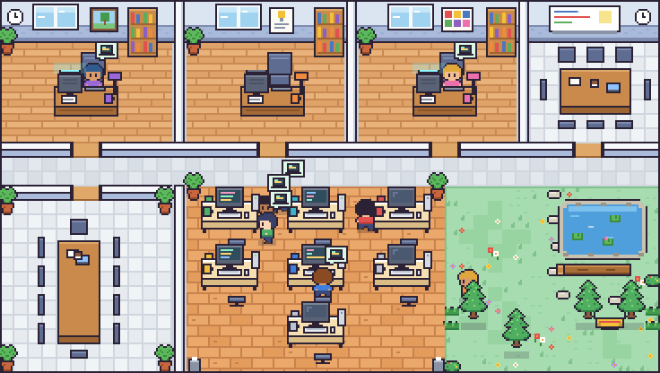

<div align="center">


# Agent Office

**See at a glance which of your Claude Code agents is working right now.**

A tiny pixel-art office inside VS Code where your AI agents work at their desks, meet up, hand in their work… and nap in the hammock when there's nothing to do.




</div>

---

## ⚡ Install in 3 steps

> 🕐 About one minute. No account, no key, no setup.

### 1. Download the extension

Go to [**Releases**](../../releases/latest) and download the **`agent-office-x.y.z.vsix`** file (under *Assets*).

### 2. Install it in VS Code

The easiest way: **drag the `.vsix` file onto the Extensions sidebar** in VS Code.

<details>
<summary>Didn't work? Two other ways</summary>

- **From the menu**: open the Command Palette (`Cmd+Shift+P` on Mac, `Ctrl+Shift+P` on Windows/Linux), type **`Install from VSIX`**, then pick the file.
- **From a terminal**:
  ```bash
  code --install-extension agent-office-1.0.0.vsix
  ```

</details>

### 3. Open the office

At the bottom of VS Code, next to the *Terminal* tab, click the **Agent Office** tab. 🎉

> 💡 Can't see it? Command Palette → **`Agent Office: Show the agent office`**.

---

## 🪄 Everything is automatic

There's nothing to configure. On startup, the extension:

1. **finds your agents** in `~/.claude/agents/` (your personal agents) and in the `.claude/agents/` folder of the open project;
2. **gives each one a desk**, based on its name:

   | If the name contains… | It sits… |
   |---|---|
   | `product-manager`, `pm`, `product-owner` | in the product manager's office |
   | `challenger` | in the challenger's office |
   | `ux`, `ui`, `design` | in the UX/UI office |
   | anything else | in the engineering open space |

   If the name says nothing about the role (`alice`, `helper`…), the extension reads the agent's **description** instead. For example, an agent described as a *product owner* still gets the product manager's office.
3. **gives each one a color**: the `color:` set in the agent's file, or else a color no other agent is using;
4. **follows Claude Code live**, every 2 seconds: who's working, who's delegating to whom, who's done.

Add a new agent and it shows up on its own. The office has room for **10 agents**.

> ℹ️ **Good to know**: the extension needs **custom agents** (the `.md` files in `.claude/agents/`). If you talk to Claude directly, without `claude --agent <name>`, no desk lights up. Only the subagents it launches do.

---

## 👀 What you'll see

| Bubble | What the agent is doing |
|:---:|---|
| 💻 | **Working.** The bubble shows up as soon as the agent starts, even while it walks to its desk. |
| 👥 | **Heading to a meeting.** An agent that delegates to several others at once gathers them in a meeting room. |
| 📄 | **Handing in its work.** When it's done, it brings the result to whoever asked for it. |
| ✅ | **Work accepted.** The agent that delegated acknowledges it. |
| 💤 ☕ | **Free.** It wanders around, chats by the pond or naps in the hammock. |
| ❓ | **Unknown status.** The character turns grey: the extension can't tell what it's doing. |

The VS Code status bar (at the bottom) also spells out who's working: *“Active agent: tech-lead”*.

---

## ⚙️ Settings (optional)

Everything works out of the box. To customize: **VS Code Settings → search for “Agent Office”**.

| Setting | What it does |
|---|---|
| `agentOffice.agentRooms` | Force an agent's office. Example: `{ "my-agent": "design" }` |
| `agentOffice.pinnedAgents` | Choose which agents come first when you have more than 10 |
| `agentOffice.pollIntervalSeconds` | How often the office refreshes (2 seconds by default) |

---

## 🔒 Privacy

- **100% local**: no network connection, nothing is sent anywhere.
- **Read-only**: the extension never changes a file and never controls an agent.
- **None of your work is shown**: no code, no conversation, no prompt. Only the agents' names and status.

---

## ❓ FAQ

<details>
<summary><b>My agents have random names and no colors. Can I tidy them up in one go?</b></summary>

Yes. Open Claude Code in your project and paste this prompt:

```text
Look at all my Claude Code agents: the .md files in ~/.claude/agents/ and in
.claude/agents/ of this project. Then:

1. Colors: in each agent's frontmatter, add or update the `color:` line using only
   red, blue, green, yellow, purple, orange, pink or cyan. Give every agent a
   different color. If I have more than 8 agents, leave the extra ones without a
   color. Don't change `name:` or anything else in the files.

2. Rooms for the Agent Office VS Code extension: pick a room for each agent:
   - "pm": the agent that leads, coordinates or talks to me (at most one)
   - "challenger": the agent that criticizes and challenges ideas (at most one)
   - "design": the UX/UI agent (at most one)
   - "engineering": everyone else
   Save the result in my VS Code user settings.json as "agentOffice.agentRooms",
   for example { "lead": "pm", "critic": "challenger" }. Keep my other settings.

3. Show me a table: agent → color → room.
```

The office updates within a couple of seconds. Your agents keep their names, so nothing changes in how you call them.
</details>

<details>
<summary><b>My agents stay idle even though they're working</b></summary>

Make sure you start Claude Code with an agent (for example `claude --agent product-manager`), or that your agent delegates to subagents. A direct conversation with Claude, without an agent, doesn't light up any desk.
</details>

<details>
<summary><b>Does it work with GitHub Copilot?</b></summary>

Copilot agents are found and shown, but greyed out: Copilot doesn't expose their activity. Only Claude Code is supported for now.
</details>

<details>
<summary><b>I'd like fewer animations</b></summary>

The extension follows VS Code's `workbench.reduceMotion` setting: when it's on, the scene stays still.
</details>

<details>
<summary><b>How do I update?</b></summary>

Download the new `.vsix` from [Releases](../../releases/latest) and install it over the old one, the same way.
</details>

---

## 🛠️ For the curious

<details>
<summary>Build the extension yourself</summary>

You need Node.js 18+ and VS Code 1.90+.

```bash
npm install
npm test          # checks that everything works
npm run package   # builds agent-office-1.0.0.vsix
```

To try it without installing: open the folder in VS Code and press `F5`.
</details>

How it all works under the hood (signals read, placement rules, accessibility, limits) is covered in the [technical documentation](docs/TECHNICAL.md).

<div align="center">

---

Inspired by [Pixel Agents](https://github.com/pixel-agents-hq/pixel-agents). The code, the sprites (drawn in code) and the office layout are original.

</div>
